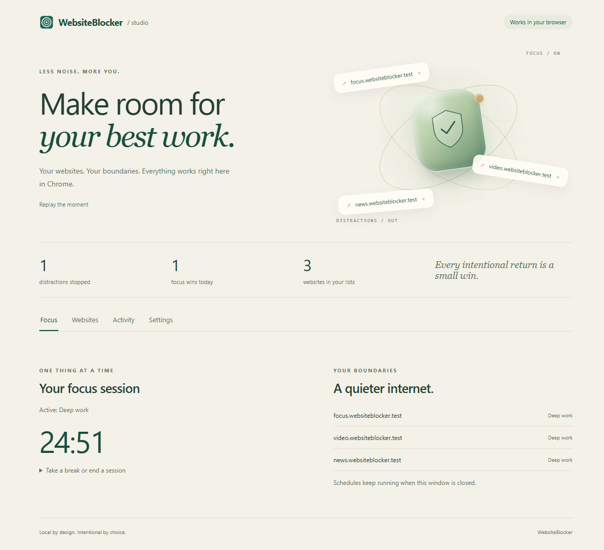
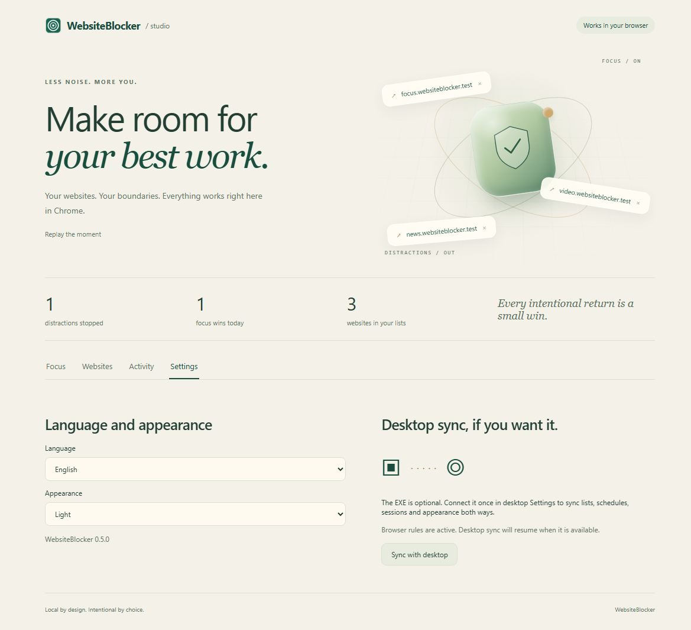
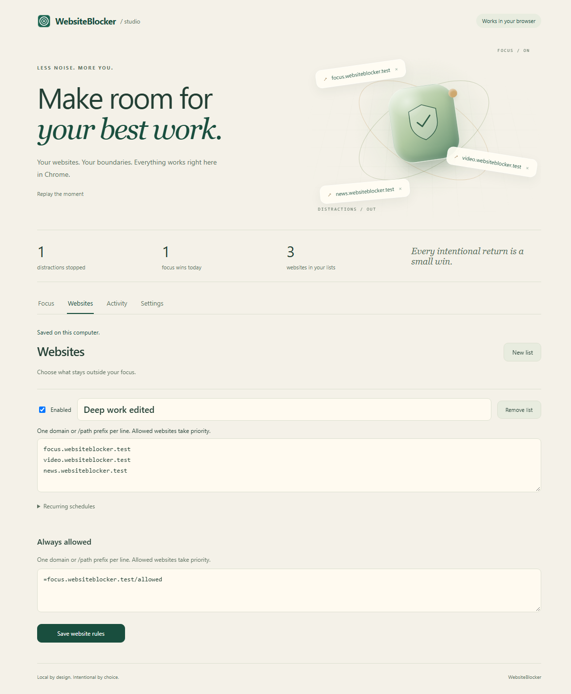
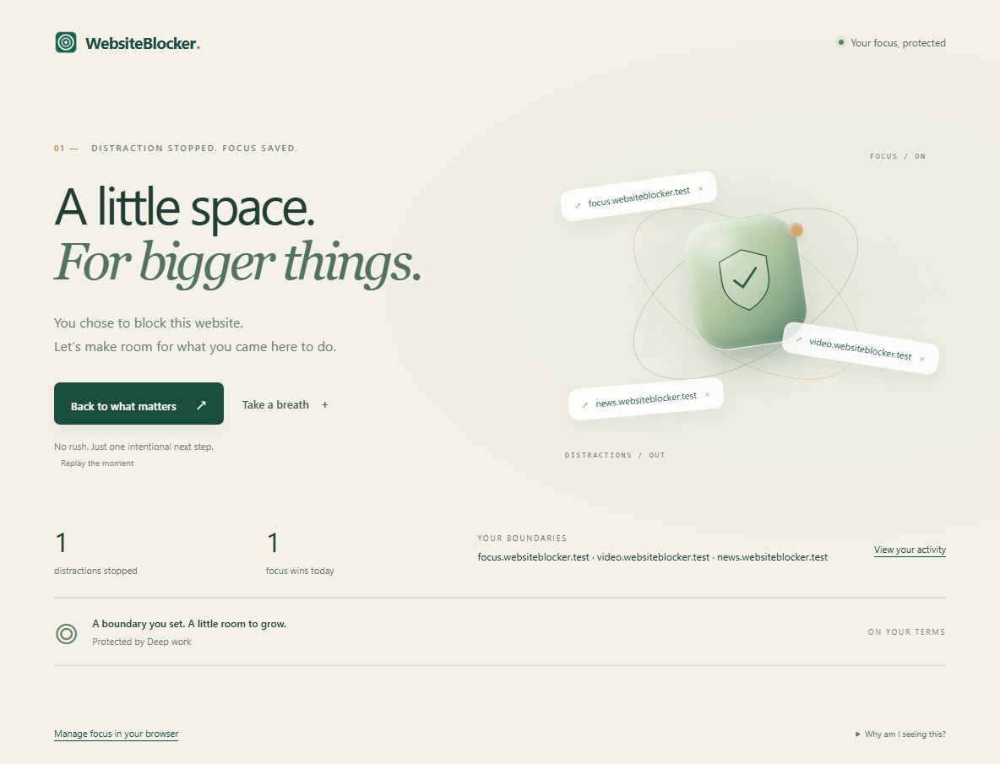
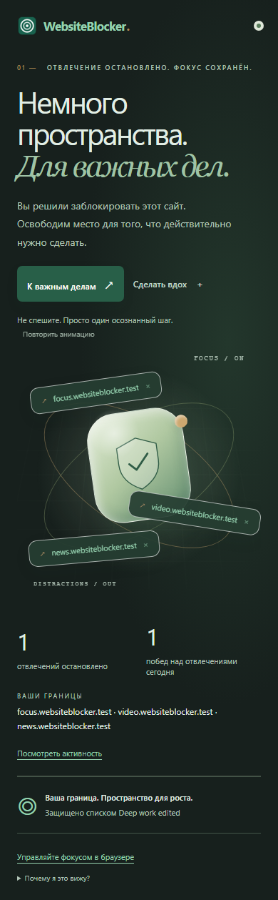
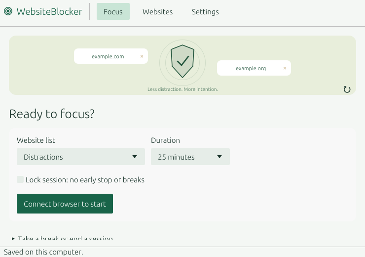
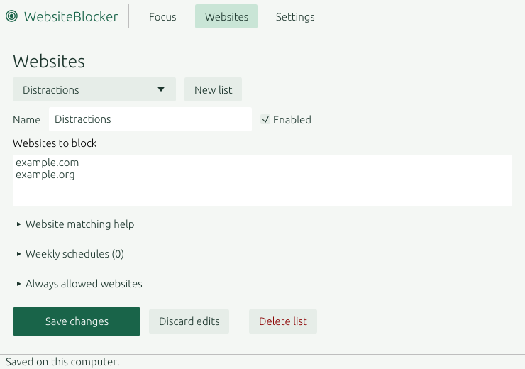
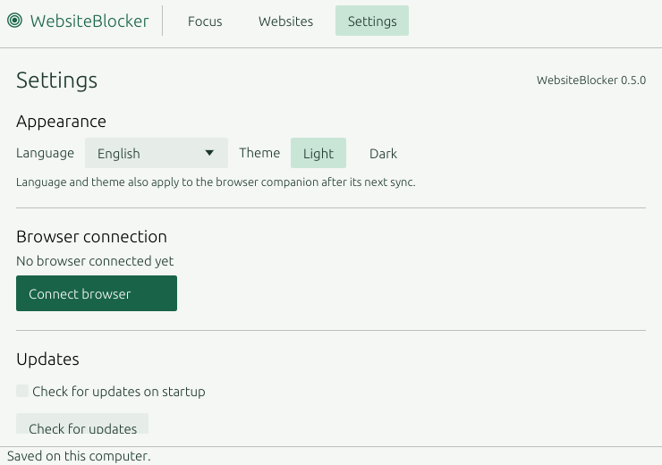
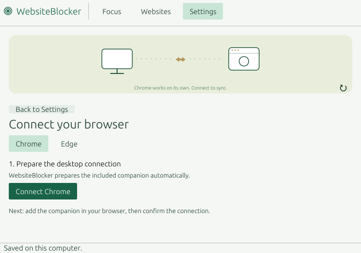
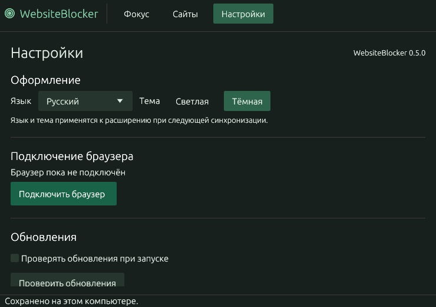

# WebsiteBlocker

A local, voluntary focus tool for Chrome and Edge. **The extension works on its own. The Windows EXE is optional.** Manage website lists, allowlists, recurring schedules, focus timers and deliberate breaks directly in your browser. Connect the desktop app if you want the same settings on both sides.

**Version 0.5.0 · Windows x64 desktop preview · Chromium Manifest V3 extension.** Independent implementation with no affiliation to Cold Turkey and no copied code or assets.

## Start without an EXE

1. Extract `WebsiteBlocker-Companion-v0.5.0.zip` into a permanent folder.
2. Open `chrome://extensions` (or `edge://extensions`), turn on **Developer mode**, choose **Load unpacked**, and select the extracted **extension** folder.
3. Open WebsiteBlocker from the browser toolbar and choose **Open focus studio**. The studio also opens after first installation.
4. In **Websites**, edit a list and choose **Save website rules**. Start a timer in **Focus**, or add a recurring schedule to your list.

No Windows app, native registration, local server, account or network request is required for browser blocking. The preview is not published in Chrome Web Store or Edge Add-ons yet, so browser installation is an explicit unpacked-extension step. Keep the extension folder in place; browser settings and counters live in the profile's extension storage.

## What it does

- Up to 20 named lists, with 50 domain or path-prefix patterns per list and a global allowlist. The combined limit is 1,000 patterns. Plain domains include subdomains; `=example.com` matches only that host. International domains normalize to ASCII.
- Focus timers from 1 to 240 minutes. Flexible sessions allow deliberate stopping. Locked sessions protect rules, early stopping and breaks until their original timer ends.
- Recurring weekday schedules in named IANA timezones, including overnight ranges and daylight-saving transitions. Rules remain available without a desktop sync; the browser refreshes its own policy rather than expiring it after eight days.
- Five-minute breaks, at most once per 30 minutes, requiring `TAKE A BREAK`. Ending a flexible session requires `END FOCUS`; scheduled blocks continue independently.
- An offline block page with a dimensional shield, incoming website tiles, impact rings, particles, a drawn checkmark, pointer parallax, a breathing exercise and a replay action. Motion is finite, stops when the tab is hidden and respects reduced-motion preferences.
- Real blocked-visit counters, today's count, top configured domains and 30 recent attempts. Reloading the block page does not count again. These measure blocked visits; the app does not invent hours saved or productivity scores.
- Desktop arrival/section transitions, spring motion, website interception and two-way packet animation on the Chrome/Edge connection page. The CPU/GDI renderer stops producing frames after transitions settle. Windows' client-area animation preference is respected.
- Six interface languages: English, Русский, Français, Deutsch, Español and Italiano. Light and dark themes are saved and synchronized. Personal list names and website addresses remain unchanged.

Example website patterns:

```text
example.com
=video.example.org/shorts
news.example.net/feed
```

`/feed` is a literal, case-sensitive prefix and also matches `/feedback`. Schemes, ports, query/fragment patterns, wildcards in paths, IP addresses and single-label intranet hosts are unsupported. Rules apply to HTTP(S) top-level navigations, including nondefault ports.

## Optional desktop synchronization

Keep `WebsiteBlocker-v0.5.0.exe` in a permanent folder. In the app, choose **Settings → Connect browser → Connect Chrome/Edge**. This prepares the embedded extension and per-user native registration. If the extension is already installed, keep that copy and choose **Sync with desktop** in its Settings. Otherwise follow the wizard's **Load unpacked** instructions. Browser consent remains explicit.

Lists, allowlists, schedules, focus sessions, breaks, language and theme synchronize in both directions. Sync normally runs every 30 seconds while the browser is awake; the desktop refreshes visible state periodically. Closing the app or removing the EXE does not stop browser enforcement, timers or local editing. Edits wait locally until the desktop becomes available again.

If both copies changed independently, **Settings** shows both list summaries and lets you choose **Use browser settings** or **Use desktop settings**. Neither copy is silently overwritten; a local backup retains the two copies after a choice. Stale revisions cannot overwrite newer settings, and synchronization cannot shorten a locked session. Attempt counters are mirrored per browser profile into the EXE and aggregated there without counting each sync again. The desktop's startup-update preference stays local to the EXE.

Upgrading from v0.4 or earlier preserves cached enforcement. Connect the v0.5 desktop once to migrate those older compiled policies back to editable browser settings. Older policies without source settings keep their original eight-day expiry until that migration.

See [browser setup and troubleshooting](docs/BROWSER-SETUP.md) and [architecture](docs/ARCHITECTURE.md).

## Desktop updates

**Settings → Updates** shows the installed version, manual **Check for updates**, a saved startup-check toggle (on by default) and user-initiated **Download and install** with progress, SHA-256 checking and restart support. Startup checks do not block launch. A missing release or compatible asset is reported as unavailable. Settings are kept outside the executable directory.

Update checks use the canonical public GitHub repository. The extension's unpacked preview updates still require replacing its files and choosing **Reload** on its browser card; its local settings survive. No store-managed update flow is claimed.

## Build and check

Rust 1.95+, Windows MSVC build tools, Node 22+ and Python are required for the relevant checks. Keep `rust-auto-updator/crates/rust-auto-updator` beside this checkout; it supplies the desktop updater. Nothing is fetched from a guessed remote.

```powershell
Set-Location E:\work\github\website-blocker
.\scripts\Check.ps1
.\scripts\Package.ps1 -Offline
python scripts/Inspect-Package.py
```

Cargo uses a repository-local target directory, at most two jobs and the static MSVC CRT. Builds/checks do not launch the UI or install extensions. Expected artifacts:

```text
dist/WebsiteBlocker-v0.5.0.exe
dist/WebsiteBlocker-Companion-v0.5.0.zip
dist/checksums.txt
```

Opt-in isolated runtime checks, after applying the rendering gate:

```powershell
python scripts/Check-Rendering.py
python scripts/Capture-Readme.py
node scripts/Browser-Standalone.mjs Chrome
node scripts/Browser-Standalone.mjs Edge
```

Browser checks use headless disposable profiles and artificial domains. They temporarily back up/replace the native-host registration, first point it at a missing EXE, then test the packaged EXE, and restore the previous value in cleanup. They do not touch normal browser profiles. Do not run them concurrently against the same browser registration. Pillow is needed for icon proofs; regular package inspection uses only Python's standard library.

## Screenshots

Real Chrome rendering with local example-domain fixtures:











Real desktop client-area PNGs from the same CPU/GDI renderer used in production; each isolated capture saves and exits:











## Privacy and limits

The browser stores rules, counts for up to 100 configured domains, 31 daily buckets, 30 recent configured-domain attempts and a bounded set of reload-deduplication tokens. It never stores the requested full URL, path, query, page contents or general browsing history. **Activity → Clear activity** resets the current profile's counters; the next desktop sync replaces that profile's mirrored counters. Other profiles keep their own counters. No external fonts, images, analytics or productivity service is used.

Desktop settings are at `%LOCALAPPDATA%\WebsiteBlocker\state.json`; synchronized per-profile counters are in its `activity` directory. The desktop validates settings, uses bounded reads, writer locks, atomic replacement and revision checks. Unsupported/corrupt settings are preserved and reported. Update checks contact GitHub; rules and activity stay local.

This is voluntary blocking, not an uninstall-proof security boundary. The machine owner can remove the extension, change the clock/settings or use another profile/browser. Already loaded pages keep running until navigation/reload; single-page history changes, embedded content, downloads, browser-internal pages and other apps are outside enforcement. Browser sleep/throttling can delay schedule/timer boundary alarms. Incognito/InPrivate needs separate browser consent. No hosts, DNS, firewall, drivers or services are changed.

Only Windows x64 desktop packaging and Chromium browsers are supported. Builds are unsigned; checksums detect corruption but do not independently authenticate the publisher. Real update installation, OS input/accessibility traversal and subjective smoothness remain separate manual checks. See [verification evidence](docs/VERIFICATION.md) and [v0.5.0 notes](docs/RELEASE-NOTES-v0.5.0.md). MIT-licensed; dependencies retain their own licenses.
