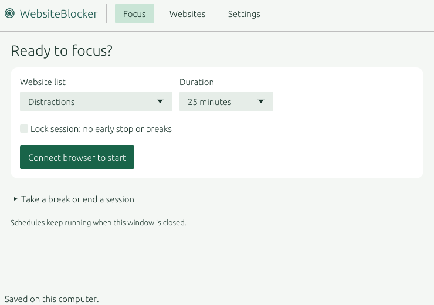
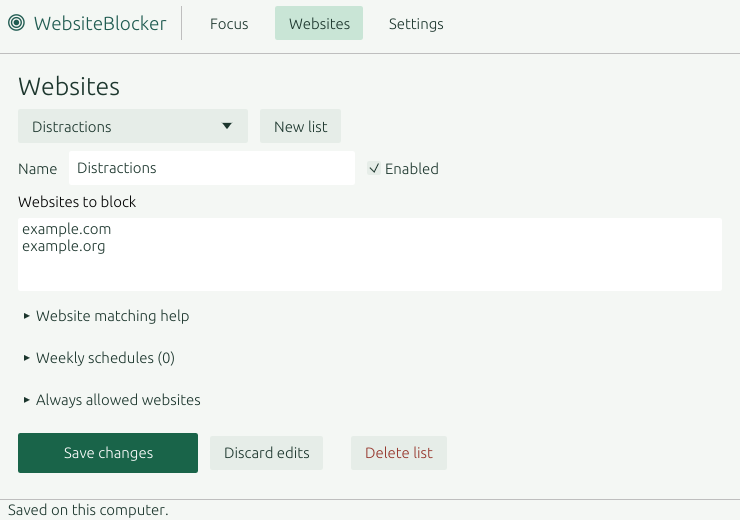
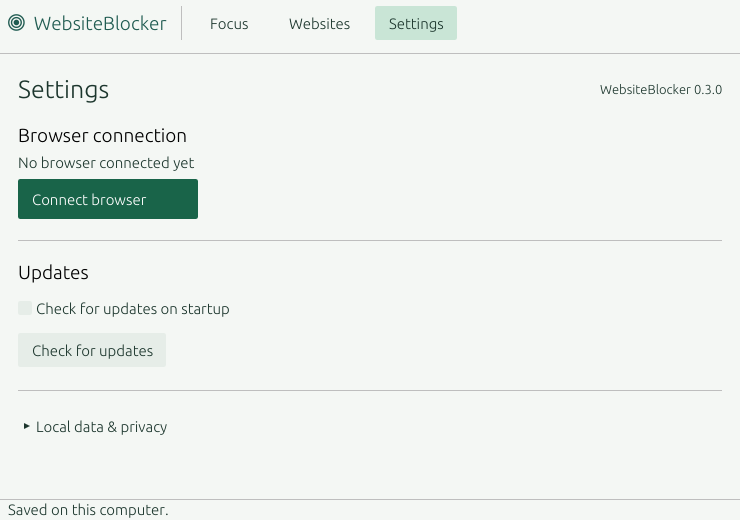
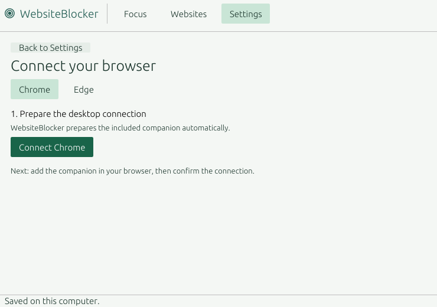
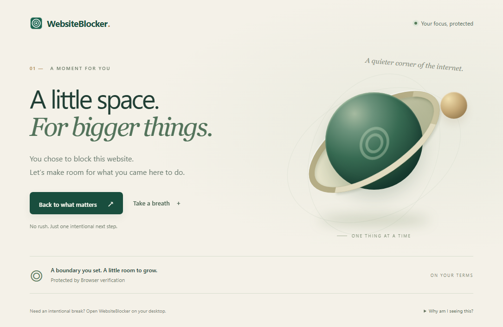

# WebsiteBlocker

A local, voluntary focus tool for websites. Manage website lists, recurring schedules and timed focus sessions in a Rust desktop app; a Chromium Manifest V3 companion enforces navigation rules in the browser. Independent implementation, with no affiliation to Cold Turkey and no copied code or assets.

**Status: local Windows x64 preview.** The desktop now uses CPU rasterization and Windows GDI. Bounded idle/minimized/hidden diagnostics, real renderer captures, and live Chrome/Edge extension checks are recorded in [verification notes](docs/VERIFICATION.md). OS input and perceived smoothness after the renderer change still need a user check; real update installation remains unverified. Nothing has been published.

## What it does

- Up to 20 named website lists with 50 domain or path-prefix patterns each (1,000 patterns total, including allowed websites). Plain domains include subdomains; `=example.com` matches only that host. International domain names normalize to ASCII.
- A global allowlist, taking priority over all active block lists.
- Focus timers from 1 to 240 minutes. Flexible sessions permit deliberate early stopping; locked sessions protect rule edits, breaks and early stopping until the timer ends.
- Recurring weekday schedules in named IANA timezones, with overnight ranges and daylight-saving transitions handled by the browser's `Intl` database.
- Five-minute breaks, at most once per 30 minutes, requiring the phrase `TAKE A BREAK`. Ending a flexible session requires `END FOCUS`; scheduled blocks continue independently.
- A custom offline block page with active-rule information, event-driven parallax, a finite breathing exercise and reduced-motion support; an extension popup with applied rule status and connection errors, and per-user native messaging without a local web server.
- **Settings → Connect browser** prepares the embedded companion and native registration. No PowerShell, JSON/registry editing or extension-ID entry is required. The wizard confirms rules were actually applied before reporting readiness.
- Local JSON settings with validation, atomic replacement, bounded reads, writer locking and stale-edit protection. Browsing history and requested URLs are not stored.
- Settings → Updates shows the installed version, manual **Check for updates**, a persistent startup-check toggle (on by default), and user-initiated **Download and install** with progress, SHA-256 checking and a restart helper. Updates require an official compatible asset and `checksums.txt`; unavailable releases are reported truthfully.

## Connect and use

1. Keep `WebsiteBlocker-v0.3.0.exe` in a permanent folder and open it. The browser companion is embedded; downloading/extracting a separate ZIP is no longer required.
2. Choose **Connect browser** from Focus or Settings, select Chrome or Edge, then **Connect Chrome/Edge**. The app prepares the companion files and per-user native registration automatically.
3. After preparation, the wizard reveals **Open Chrome/Edge extensions** and **Copy companion folder**. For this unpublished local preview, turn on **Developer mode** in that browser page, select **Load unpacked**, paste the copied path into the folder picker’s address bar (**Ctrl+L**, paste, **Enter**), then choose **Select folder**. No command, extension ID or configuration-file edit is needed.
4. The companion opens a welcome page and connects automatically. WebsiteBlocker confirms when current rules are applied. Repeat for another browser/profile if needed.
5. Edit **Websites**, save, then start a short flexible focus session. Before a browser is connected, the main action takes you to setup instead of starting an ineffective session.

**Preview distribution limit:** the companion is not published in Chrome Web Store or Edge Add-ons yet. The browser installation/consent step cannot be silently completed by the desktop app; Chrome on Windows requires store distribution for ordinary external installation. The app does not change browser preferences, use policies, enable Developer mode or install an extension without the browser step. See [browser setup and troubleshooting](docs/BROWSER-SETUP.md).

Example pattern list:

```text
example.com
=video.example.org/shorts
news.example.net/feed
```

`/feed` is a literal, case-sensitive prefix: it also matches `/feedback`. Schemes, ports, query/fragment patterns, wildcards in paths, IP addresses and single-label intranet hosts are intentionally unsupported in v0.1. Rules apply to HTTP(S) top-level navigations, including navigations on nondefault ports.

Closing the desktop app leaves browser schedules active. The extension refreshes native state about every 30 seconds while awake and also schedules boundary alarms. Browser throttling/sleep can delay transitions; a 30-second refresh is not a hard real-time guarantee. On connection failure, the last usable policy continues locally for up to eight days, with its original focus end time. After expiry or a detected large clock rollback, blocking clears and the popup reports an error. A user who changes rules while disconnected must reconnect the extension before those edits take effect.

## Build and check

Use Rust 1.92+ with the Windows MSVC toolchain, its existing C++ build tools, and Node 22+ for dependency-free extension tests. Build commands never launch the GUI, install the extension, register a host or run the updater.

```powershell
Set-Location E:\work\github\website-blocker
cargo fetch --locked                       # only when dependencies are not already cached
.\scripts\Check.ps1                        # offline formatting, Clippy and isolated tests
.\scripts\Package.ps1 -Offline              # Windows x64 EXE, companion ZIP, checksums
python scripts/Inspect-Package.py           # inspect PE/ZIP/hashes without execution
```

Cargo uses a repository-local `target` directory, at most two build jobs and the static MSVC CRT for Windows x64. The workflow prepares build artifacts without publishing releases. First dependency fetch requires network access; the implementation environment used existing cached crates.

Expected local artifacts:

```text
dist/WebsiteBlocker-v0.3.0.exe
dist/WebsiteBlocker-Companion-v0.3.0.zip
dist/checksums.txt
```

The single executable contains the desktop app, native host and companion source. The wizard extracts the extension to its managed local-data folder; Chromium still loads it separately. The companion ZIP is optional for legacy/developer distribution. Only Windows x64 packaging is provided. Firefox is a future port, not supported in this release.

## Limits and privacy

This is not a security boundary or an uninstall-proof lock. The machine owner can disable/remove the extension, change local settings or the clock, use a different profile/browser or edit the source. It does not change hosts, DNS, firewall settings, processes, services or devices. No application/process blocking is included.

Already loaded pages keep running until a navigation/reload; single-page-app history changes, embedded content, downloads, internal browser pages and other applications are outside this version's enforcement scope. The extension requests HTTP(S) host access to redirect selected navigations, plus declarative rules, local storage, alarms and native messaging permissions. Incognito/InPrivate requires separate consent in the browser.

Settings live at `%LOCALAPPDATA%\WebsiteBlocker\state.json`. Keep a copy before manually editing. Corrupt or unsupported files are preserved and reported. Updater downloads and result logs live under `updates/`; personal settings are kept outside the EXE directory and are not replaced during updates. Update checks contact GitHub only; browser policies stay local. SHA-256 detects incomplete or corrupted assets but is not an independent publisher signature. Builds are currently unsigned.

## Screenshots

Real client-area captures from the application's CPU/GDI renderer, using disposable example-domain settings at 740 × 520 pixels. Each capture saves a PNG and exits; no desktop automation is needed. Startup update checks are disabled in these fixtures only.









Real Chrome rendering of the local companion’s block page (no external fonts or images):



For a bounded developer capture after applying the rendering gate:

```powershell
python scripts/Check-Rendering.py           # 16.5-second isolated diagnostic, then exits
python scripts/Capture-Readme.py            # four real renderer captures, each exits
```

Native icon verification in `Check-Rendering.py` and asset regeneration with `Build-Icons.py` require Pillow. The regular package inspector uses only the Python standard library. See the native resource and assigned-icon proofs in [verification notes](docs/VERIFICATION.md).

These are explicit GUI diagnostic commands, separate from the noninteractive build checks. The diagnostic reports actual layout/raster/present counts and CPU time. It does not certify OS input, accessibility traversal or subjective smoothness.

See [architecture](docs/ARCHITECTURE.md), [manual checks and verification](docs/VERIFICATION.md), and the [current preview notes](docs/RELEASE-NOTES-v0.3.0.md). MIT-licensed; third-party dependencies retain their own licenses as declared in their pinned crate distributions.
