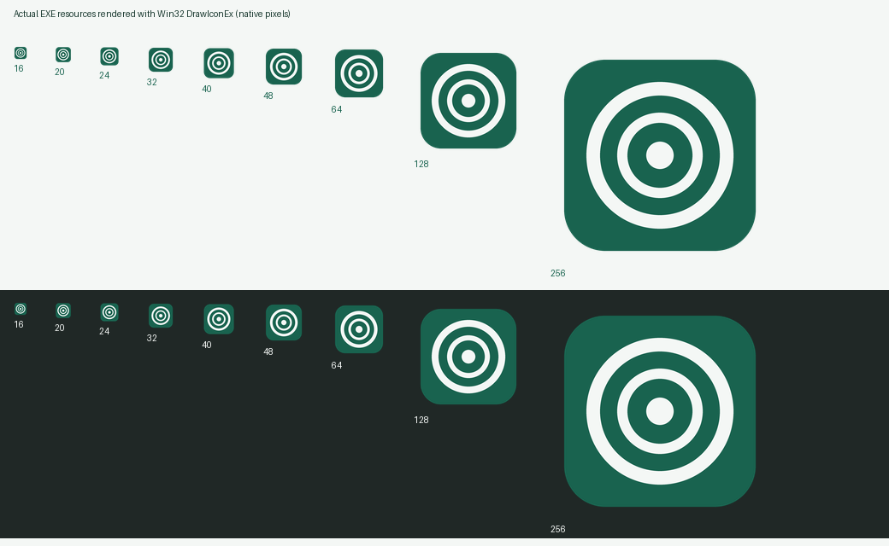
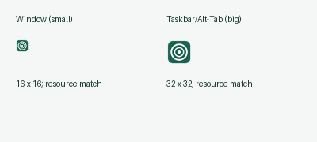
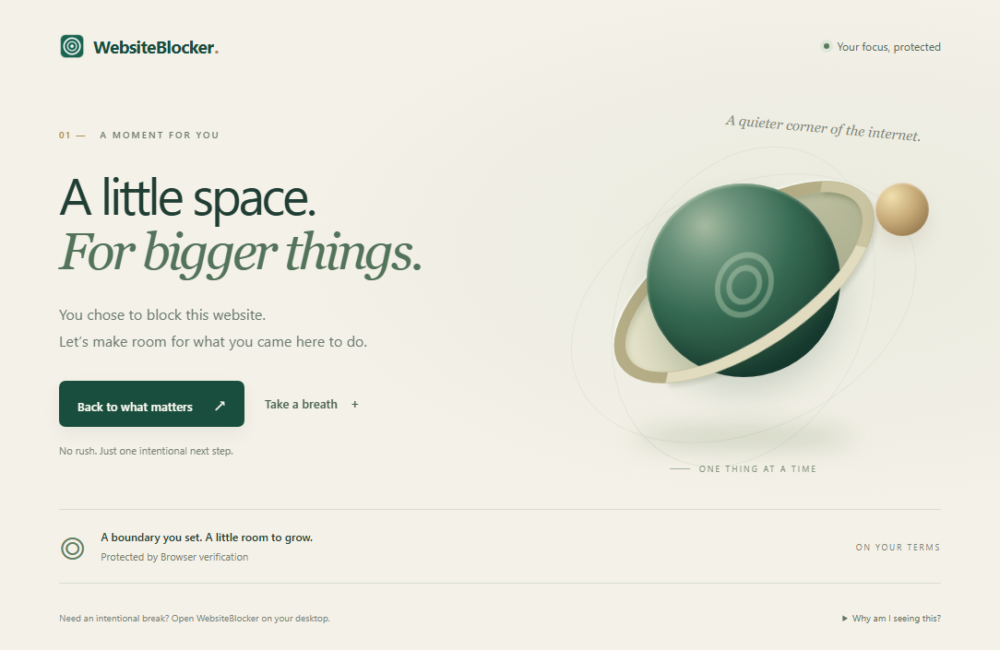

# Verification record

Initial record: 2026-10-31 (Europe/Minsk). All work used this repository, isolated artificial settings and at most two Cargo jobs. Nothing was published; no remote Git operations occurred. Normal browser profiles, user data, hosts/DNS/firewall settings and drivers were not changed.

## Version 0.4.0: six languages and saved appearance (2026-11-01)

Added complete English/Russian/French/German/Spanish/Italian desktop catalogs and browser catalogs. Settings → Appearance changes language and Light/Dark without restarting; defaults on legacy settings are English/Light. Regression checks preserve existing list names, locked focus state, unsaved website edits and update preferences while saving appearance and exporting it in browser policy. Catalog checks validate every translation and placeholder, generated browser files and all six embedded manifest locales. Consumer labels/status text were audited; names, website/timezone/path data, fixed confirmation phrases and technical error details intentionally retain their original text.

The egui theme preference is explicitly selected, including the native SetTheme viewport command. Typography and spacing are configured for both light and dark styles. A regression feeds the opposite operating-system theme after each saved selection and checks that the selected theme and UI geometry remain in effect.

The optimized final Windows x64 EXE uses `egui CPU software rasterizer → softbuffer Win32 GDI`. Source inspection confirmed event/deadline-based wakeups, retained bitmap blits and no hidden layout/raster/presentation. Final isolated diagnostics used exact PIDs **40136** (English/Light) and **37800** (Russian/Dark), each exiting after 16.5 seconds. Both passed visible settled idle (5 s), minimized (2 s), restored settled idle (3 s) and hidden (2 s) samples with **0 layout/raster/present**, 0 cached blits and 0 ignored external inputs in every sample. Light had no measurable CPU increase except one 0.015625 s quantum while hidden (0.781% of one core, 0.0391% of the 20-core machine); Dark had no measurable increase in all samples. The targeted module check found `gdi32.dll` only. GPU/compositor telemetry and perceived input smoothness remain unmeasured.

Native EXE-resource rendering verified all nine 16–256 px icon sizes, and both assigned icon handles matched the resource on the final diagnostic PID. Fresh 740 × 520 client-area PNGs were inspected for Focus, Websites, Settings and browser setup, plus Russian/Dark Focus and Settings and German browser setup. Translated labels fit, language/theme selection is visible, and both palettes retain readable controls. These are real renderer captures, not OS title-bar/taskbar screenshots. All capture processes exited.

Headless Chrome **156.0.8078.74** and Edge **156.0.4314.58** each passed **11 isolated visual-policy checks**. They load the real companion, obtain a framed policy from the EXE without opening its desktop window, apply actual DNR redirect/allow rules, and verify navigation, host/path boundaries, active-list text, breathing controls, event-only parallax, reduced motion and 390/768 px layouts. Each also exercises all **six languages × two themes** through live storage policy updates, preserves personal list names, and checks translated headlines, palette backgrounds and absence of horizontal overflow at 390 px. Real English, Russian/Dark and French/Light browser PNGs were reviewed. These tests write only disposable profiles and artificial state; they make no native registration changes.

Build checks: formatting, all-target Clippy with warnings denied, **20 Rust tests**, **9 Node tests**, offline locale-generation verification and optimized Windows x64 compilation. The package inspector verifies matching desktop/companion/resource versions, required locale files, PE architecture/icons, ZIP integrity and both SHA-256 checksums. Ordinary OS input, accessibility traversal, native picker interaction, mixed-DPI movement, perceived smoothness and real update installation remain separate manual checks. Historical records below retain their original version/evidence.

## Version 0.3.0: identity, copy path and compact UI (2026-11-01)

The final EXE is `dist/WebsiteBlocker-v0.3.0.exe`, **7,538,688 bytes**. Application/companion versions and Windows file/product metadata agree. Formatting, all-target Clippy, **17 Rust tests** and **7 Node tests** passed. The new copy-path regression checks a real prepared folder with spaces/Unicode, normal Windows separators, removal of the verbatim prefix and rejection of a missing manifest. Preparation also rejects stale companion manifests as readiness evidence, and an upgrade regression verifies repair through preparation. Embedded asset coverage includes every manifest icon reference.

The missing-icon defect was real: earlier EXEs had no icon resource and the window had no icon assignment. The package inspector now requires all nine 16/20/24/32/40/48/64/128/256 px icon resources to match the committed ICO. Read-only Win32 resource mapping and DrawIconEx rendering verified nonblank output on light/dark backgrounds. WM_GETICON on the exact final diagnostic PID **43784** returned 16 × 16 and 32 × 32 icons whose rendered pixels matched the EXE resource. These are resource/handle proofs, not Explorer, taskbar or Alt-Tab screenshots. Resource-data mapping follows [Microsoft's native icon workflow](https://learn.microsoft.com/en-us/windows/win32/menurc/using-icons).

The final CPU/GDI diagnostic used an isolated, input-disabled window omitted from the taskbar, 20 logical cores and a 22-second external bound. Visible settled idle (5 s), minimized (2 s), restored settled idle (3 s) and hidden (2 s) samples each had **0 layout/raster/present**. Visible, minimized and restored intervals had no measurable CPU-time increase; hidden accounted for one 0.015625-second CPU-time quantum (0.781% of one core, 0.0391% of the machine over two seconds). Zero external input events were counted in these intervals. Native minimize/restore/hide states and retained-frame presentation were checked; the process exited. The target's selected graphics-module check found gdi32.dll only. This does not measure the desktop compositor or certify normal input latency.

An intermediate v0.2.1 diagnostic had 677 ignored input events, focus changes and an unexpected restore before its minimized sample; it failed and was not used as idle evidence. Disposable visual-test windows are now explicitly labeled, disabled for input and omitted from the taskbar to prevent interference with the user's working copy. Normal activation/taskbar behavior is unchanged.

Four fresh real renderer captures were reviewed at **740 × 520**. The initial window is smaller than the previous 880 × 680 build. List/duration controls share a row, repeated help is removed, and setup reveals later steps only when ready. Capture review exposed a fixed maximum content width overflowing the smaller viewport; it was corrected to respect available width, then all screens were recaptured with no clipped version text or action buttons. Settings visibly shows 0.3.0. All capture processes exited.

Chrome 156.0.8078.48 and Edge 156.0.4314.50 each passed **10 isolated visual-policy checks** for this version. These obtain a real framed snapshot from the new EXE directly, feed it through the actual extension engine/DNR API in disposable profiles, and verify blocked navigation, allow priority/host/path boundaries, actual active-list text, image loading, working breath controls, event-only parallax, settled animation state, reduced-motion behavior and 390/768 px layouts. Real desktop/mobile browser PNGs were reviewed. The page uses only local CSS/JS/assets.

The managed native-transport test encountered an existing registration outside its fixture directory and correctly refused to overwrite it. The final visual tests changed no native registration. They do not repeat the full browser-to-native transport checks recorded for v0.2.0 below. Normal profiles/settings were preserved; no computer-use/CUA, injected OS input, global icon-cache edits or publication occurred.

The remaining manual checks still apply: native folder-picker paste/selection and clipboard behavior during ordinary use, Explorer/taskbar appearance and pinned shortcuts, mixed-DPI moves, OS input/perceived smoothness and actual updater installation. The screenshots and handle checks establish their stated scope only.

## Version 0.2.0 follow-up (2026-11-01)

The application package, embedded companion and Settings version now identify this local preview as **0.2.0**. Earlier changes had been handed over under an unchanged 0.1.0 label; those records below are historical. No remote publication occurred. Diagnostic, capture and browser-smoke defaults now derive the EXE name from the current manifest version instead of selecting an old executable.

- Formatting, all-target Clippy, **16 Rust tests** and **7 Node tests** passed for 0.2.0.
- Chrome 156.0.8078.48 and Edge 156.0.4314.50 each passed **15 managed headless checks** against `dist/WebsiteBlocker-v0.2.0.exe`, including embedded extraction, native registration and version-matched applied-rule confirmation. Temporary native registration was restored; normal profiles were not used.
- The 16.5-second CPU/GDI diagnostic used PID 33240 and the new **7,432,704-byte** EXE. Visible idle (5 s), minimized (2 s), restored idle (3 s) and hidden (2 s) samples each had zero new layout/raster/present and no measurable process CPU-time increase. No external input was ignored in those samples. Restore presented the retained frame and the process exited normally.
- Four real renderer captures were refreshed and inspected at 880 × 680; Settings visibly shows WebsiteBlocker 0.2.0. Capture processes exited. Computer use and injected OS input were not used. Normal input/perceptual smoothness and the remaining manual checks below are still unverified.

## Connection-wizard follow-up

The current preview includes Settings/Focus → Connect browser. The EXE embeds the companion, extracts it into a managed directory and registers the native host through Rust/Win32 APIs after an explicit user action. Users do not need PowerShell, an extension ID, or JSON/registry editing. An unpublished Windows Chrome extension still needs Developer mode/Load unpacked in the browser; the wizard opens that page, copies the folder path and verifies applied rules. No store listing or silent installation is claimed.

- Current noninteractive checks passed: formatting, all-target Clippy with `-D warnings`, **16 Rust tests** and **7 Node tests**. Setup tests cover fixed-key identity, exact embedded files, idempotent per-browser preparation, preservation of rules and foreign registrations, failure handling and fresh/current applied-rule reports.
- **Chrome 156.0.8078.48 and Edge 156.0.4314.50 each passed 15 headless live checks** using the actual distributable EXE and managed embedded companion. The additional check calls the same Rust registration/preparation backend as the GUI, then calls its inspection path to confirm readiness after real DNR application. Per-user native values were backed up/restored and normal profiles were not used. No computer-use/CUA or injected OS input was used.
- Four real CPU-renderer client-area PNGs (880 × 680) were recaptured and inspected: Focus, Websites, Settings and the connection wizard. Each capture exited; README links the actual files. Native file-picker/browser-consent interactions remain a user/browser step and were not driven through desktop automation.
- The latest packaged EXE is **7,432,704 bytes**. Its native protocol and embedded extraction were exercised in the browser tests; later changes only affected the GUI/presenter and diagnostics.

Final rendering diagnostic: PID 44088, actual distributable EXE, CPU software renderer → Win32 GDI, 20 logical cores. The running module check found gdi32.dll and none of the selected OpenGL/D3D/DXGI/Vulkan modules. The 5-second visible-idle, 2-second minimized, 3-second restored-idle and 2-second hidden intervals each had **0 new layout/raster/present and no measurable process CPU-time increase**. There were no cached OS exposure blits or ignored external input events within these final intervals. Restore explicitly presented the retained bitmap. The process exited normally.

An intermediate diagnostic had 857 layouts/rasters/presents during a five-second sample. A bounded trace showed incoming cursor events separated by frames with no requested repaint; that sample was not clean idle. Normal rendering now skips raster/present when scene/scale/size/textures are unchanged while still processing input, and retains native expose/restore blits. Diagnostic/capture mode ignores real user input to protect disposable fixtures and counts it separately; the final intervals had zero such events. The diagnostic frame bound prevents continuing an unexpected redraw storm. These checks do not certify normal pointer/scroll latency, accessibility, high DPI or the user's subjective smoothness.

The remaining manual/release checks below still apply. The older baseline is retained for history and does not describe the latest connection workflow.

## Previous rendering baseline (historical)

| Check | Result |
| --- | --- |
| `scripts/Check.ps1` | Passed: rustfmt, all-target Clippy with `-D warnings`, 12 Rust tests, 7 Node tests, parsing all PowerShell scripts |
| Windows release packaging | Optimized x64 MSVC build, static CRT, version-matched companion ZIP and SHA-256 sidecar |
| `scripts/Inspect-Package.py` | PE architecture/subsystem, static CRT/GPU-import checks, ZIP entries/integrity and asset checksums |
| `scripts/Check-Rendering.py` | Bounded isolated CPU/GDI diagnostic; process exited normally |
| `scripts/Capture-Readme.py` | Three real software-renderer PNGs, each capture exited; images inspected and embedded in README |

The packaged EXE is 7,273,472 bytes. Build artifacts and disposable profiles/results remain under ignored `dist/` and `.test-output/`. Cargo's incremental hard-link warning falls back to copies and did not prevent checks. CI is configured but has not run remotely.

Rust coverage includes domain/path and normalized browser-matcher fixtures, overnight/week boundaries, exact focus/break transfer, persistent lock/cooldown policy, corrupt-file and stale-revision protection, framing/limits/mutation rejection, release/checksum selection, staged replacement and time-input bounds. A regression checks that changing startup-update settings or starting focus preserves unsaved website/name/allowlist drafts; explicit reload still discards them. Node covers named zones and DST, cached timer expiry/clock rollback, actual DNR payload shape, allow priority, policy rejection and failed-application cache recovery.

## Rendering and load gate

The original Glow/OpenGL window caused severe lag reported by the user. Extended desktop automation stopped. There is no quantitative old-renderer baseline: the problematic build was not reopened to obtain one. The renderer and host were replaced with CPU software rasterization and Win32 GDI, and unconditional periodic UI rendering was removed. Source/pinned-dependency review preceded the bounded tests.

Final tested executable: `E:\work\github\website-blocker\dist\WebsiteBlocker-v0.1.0.exe`; PID 33284, version 0.1.0, optimized Windows x64 build, 20 logical cores. Actual pipeline: egui -> egui_software_backend 0.0.2 CPU -> retained BGRA bitmap -> softbuffer 0.4.8 Win32 GDI. The pinned Win32 presentation source uses BitBlt. Targeted running-process module observations found only gdi32.dll among GDI/OpenGL/D3D11/D3D12/DXGI/Vulkan names; package import inspection also excludes GPU renderer DLLs. This does not disable the Windows compositor or measure its GPU usage.

| State | Sample | CPU, one logical core | New layout / raster / present |
| --- | --- | --- | --- |
| Visible, settled, unchanged | 5 seconds | 0.000% | 0 / 0 / 0 |
| Minimized | 2 seconds | 0.000% | 0 / 0 / 0 |
| Restored, settled | 3 seconds | 0.000% | 0 / 0 / 0 |
| Hidden | 2 seconds | 0.000% | 0 / 0 / 0 |

CPU figures are differences in Windows process CPU time and reflect its quantization, not a claim of infinitely precise zero cost. Machine-normalized CPU was also 0.000% over these intervals. Startup produced two useful frames, and restore produced one more; there was no self-sustaining frame loop. Window queries confirmed minimized, restored and hidden states. Maximum observed layout/raster/present time across those three frames was 2.00 / 6.19 / 1.29 ms; these are sparse diagnostic observations, not interaction percentiles.

The first diagnostics reached all phases but failed to exit before their external timeout. Instrumentation exposed the winit Win32 AboutToWait/exit wait transition; the host now expires that final wait and releases its GDI surface/window during exiting. The final diagnostic exited normally within its 22-second external bound. Capture also has internal readiness/frame/time limits and a separate 30-second external timeout.

The static/idle/hidden portion of the gate passed. Normal mouse/keyboard interaction, scroll/resize responsiveness and subjective system-wide smoothness remain unverified after replacement because the user requested no computer use. No computer-use/CUA or injected OS input was used during this repair phase. The diagnostic uses only its own window lifecycle and read-only process measurements. GPU/compositor telemetry was unavailable. Do not describe these results or the PNGs as proof that the user's original perceptual symptom is resolved.

## Live browser verification completed earlier in this task

Chrome 156.0.8078.48 and Edge 156.0.4314.50 each passed 14 real-browser checks with disposable profiles and harmless local HTTP fixtures. This was before the desktop renderer replacement; matching, native framing and the browser extension source are unchanged by that replacement.

Checks covered actual EXE native messaging without a desktop window, accepted DNR allow/redirect rules, real block-page navigation, subdomains, path allowlist priority/case, unrelated-domain boundaries, rejection of a native mutation request, pauses, invalid timezone rejection with last-policy retention, a recurring UTC schedule, native disconnection with cache retention, expiry while disconnected and recovery. Results/screenshots are saved under `.test-output/live-chrome/` and `.test-output/live-edge/`.

The test installed the unpacked extension only into disposable profiles and temporarily changed the exact per-user native-host default value. It backed up/restored the prior value and closed the test browser afterward. No regular profile or credentials were used. Chrome used a DevTools pipe. Edge's launcher exited when using that pipe, so its successful test used a local DevTools port in a new disposable profile. This is a test-harness transport difference, not an extension enforcement failure.

## Visual review

README images are real client-area 880 x 680 captures of the same production CPU renderer with example.com/example.org fixtures. They show Focus, Websites and Settings. They do not show native title bars, OS menus, permission prompts or tray interactions. Startup updates are disabled in those fixtures only. The review checked readable typography, consistent green/neutral colors, clear primary actions, spacing and absence of clipping on those screens. Smaller controls and excessive always-visible guidance from the previous layout were replaced by larger controls and expandable secondary details.

## Remaining checks before release

- [ ] User confirmation of perceived smoothness and a later permitted OS-input walkthrough: focus, stop/break phrases, editing, dropdowns, keyboard traversal and scrolling.
- [ ] Active-input/resize CPU and frame/present latency; minimized/restore visuals during ordinary use; 150/200% DPI, narrow windows, long names and error states.
- [ ] Incognito/InPrivate consent and behavior; browser sleep/wake and observed alarm delays; older declared browser versions.
- [ ] Real update checks/download/install/restart against a controlled release, including invalid hashes, interruption, read-only installation directory and rollback errors. No real updater was executed.
- [ ] Extension upgrades/uninstall and long cache-expiry behavior in a normal, explicitly authorized profile.
- [ ] Release signing/licensing review and canonical repository availability before any future publication.

There is no tray resident process or tray interaction to validate: closing the desktop exits and enforcement remains in the browser. Builds remain unsigned and Firefox unsupported.

## Shared updater extraction audit (2026-11-01)

The existing Updates UI, persisted startup opt-out and explicit installation action now delegate canonical release selection, verified download/progress, PE validation, same-volume replacement, rollback and cleanup to the sibling `rust-auto-updator` core. Product configuration retains `WebsiteBlocker-vVERSION.exe`, `checksums.txt` and the 200 MiB limit. `--apply-update` runs before normal application/native-host startup; the relaunched application accepts the validated `--cleanup-update` route. Previously released versions copy their own executable as the old helper, which can install the migrated executable normally. No real update or external release download was executed during this audit.

Rust 1.95+ and sibling source provisioning are now required; no guessed remote dependency was introduced. A plain single-repository hosted CI checkout cannot build until the shared source is provisioned. Source commits do not hand over a new distributable or overwrite the previous `dist` files.

All-target Clippy, 16 Rust tests and 7 Node extension tests passed. The shared updater owns generic checksum/replacement regressions; the product regression verifies the existing `checksums.txt` release contract and rejection of an untrusted asset address. Icon/window/tray policy remains the intentional desktop-only application with no background tray process.

The final optimized `target/release/website-blocker.exe` passed the finite 16.5-second diagnostic with PID **27992**. Settled visible (5.02 s), minimized (1.98 s), restored idle (3.00 s) and hidden (2.00 s) intervals each had **0 layout/raster/present** and no external input. CPU was 0% of one core for visible/restored/hidden and 0.790% for minimized (one timer-resolution CPU quantum, 0.0395% of the 20-core machine). Backend evidence combined the actual CPU raster/present source, frame counters and selected module query (`gdi32.dll` only); compositor/GPU telemetry was unavailable. Restore produced a fresh frame and the process exited within the external limit.

The same final EXE's nine packaged icon resources exactly match the committed ICO. Native Win32 resource rendering was inspected on light/dark backgrounds, and its live diagnostic window returned resource-matching **16×16** window and **32×32** taskbar handles. These PNGs are resource/handle proofs, not OS screenshots. The icon/renderer interface did not otherwise change, so the existing real README app/settings images remain representative. Input latency and real OS tray/taskbar interaction remain untested under the user's no-computer-use restriction.
